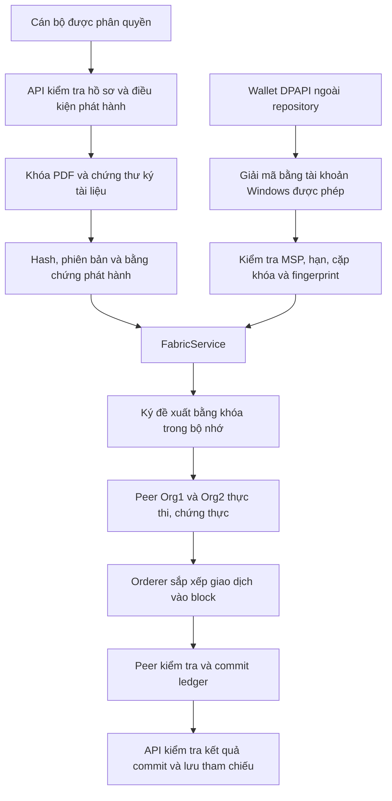

# Quản lý khóa DiplomaChain

Ngày lập: 04/11/2026. Phạm vi: máy Windows phát triển hiện tại; không phải chứng nhận an toàn production.

## Lựa chọn triển khai

Không đưa khóa lên blockchain hoặc GitHub. Với máy đồ án hiện tại, wallet ứng dụng dùng Windows DPAPI **CurrentUser**, đặt tại thư mục riêng của tài khoản Windows, ngoài mã nguồn:

```text
%LOCALAPPDATA%\DiplomaChain\secrets\<mã-workspace>\
```

DPAPI sử dụng cơ chế bảo vệ của Windows, không cần đặt một mật khẩu giải mã rõ cạnh wallet. API giải mã trong bộ nhớ và tạo đối tượng khóa để ký, không tạo file PEM/private key rõ lúc chạy. Khóa và chứng thư ứng dụng không được cấp mới; fingerprint được ghim bằng cấu hình.

Đây là ranh giới bảo vệ giữa các tài khoản Windows, không phải ranh giới chống mã độc đang chạy bằng chính tài khoản được phép. Máy chủ thực tế nên dùng tài khoản dịch vụ riêng, secret manager/KMS/HSM phù hợp và khóa ký số được cấp đúng thẩm quyền. DPAPI CurrentUser không tự dùng được trong Linux container.

## Bảng quản lý

| Nhóm                         | Nơi lưu hiện tại                                                                   | Người/tiến trình cần dùng                             | Cách bảo vệ và giới hạn                                                                                                                                                  |
| ---------------------------- | ---------------------------------------------------------------------------------- | ----------------------------------------------------- | ------------------------------------------------------------------------------------------------------------------------------------------------------------------------ |
| JWT, NextAuth, DB, email, AI | Các file môi trường API, Web, hạ tầng                                              | API/Web và tác vụ triển khai tương ứng                | ACL riêng; không commit hoặc ghi giá trị vào báo cáo. Các mật khẩu này vẫn là cấu hình rõ khi tài khoản được phép đọc file.                                              |
| Wallet giao dịch Fabric      | Vault ngoài repository; bản tương thích tại wallet/issuer-org1.json cũng đã mã hóa | API Windows chạy bằng tài khoản bảo vệ wallet         | DPAPI CurrentUser, MSP đúng, cặp khóa/chứng thư khớp, chứng thư còn hạn, fingerprint được ghim.                                                                          |
| Bản khóa enroll của ứng dụng | wallet/issuer-org1-msp/keystore                                                    | Chỉ phục vụ cấp/đổi danh tính, không phải API runtime | Cũng được bọc DPAPI sau sao lưu; Fabric CA CLI không còn đọc trực tiếp bản đã bọc như PEM. Phải khôi phục bằng quy trình bảo mật hoặc cấp danh tính mới khi cần gia hạn. |
| Fabric administrator         | organizations/.../users/Admin@.../msp/keystore                                     | Tác vụ quản trị mạng, không cấp cho API               | PEM giữ nguyên để không phá Fabric; siết ACL. API không tự chuyển sang khóa Admin.                                                                                       |
| Peer/orderer MSP             | organizations/.../peers hoặc orderers/.../msp                                      | Node tương ứng                                        | Giữ định dạng Fabric; ACL bảo vệ trên host. Cần kiểm tra thêm mount chỉ đọc và tài khoản container khi triển khai chính thức.                                            |
| Node TLS                     | organizations/.../tls                                                              | Peer/orderer/CA tương ứng                             | Không thay key/cert hoặc ghim TLS trong lần này. Chứng thư công khai không phải khóa bí mật.                                                                             |
| CA/TLS CA                    | organizations/fabric-ca và các thư mục ca/tlsca                                    | CA và quản trị PKI                                    | Không đưa khóa CA vào API; không mã hóa PEM tại chỗ khi dịch vụ Fabric cần đọc trực tiếp.                                                                                |
| Ký PDF, CA/TSA nội bộ        | .data/signing                                                                      | API ký PDF; dịch vụ CA/TSA dùng khóa riêng            | PEM đang có giữ nguyên. Mật khẩu trong settings/identities/env được bảo vệ ACL nhưng vẫn cùng miền tài khoản; chưa phải USB Token/HSM.                                   |
| Bản sao khóa cũ              | .data/fabric-backup-\*/organizations; bản sao cấu hình lịch sử                     | Chỉ khôi phục/sự cố                                   | Kiểm kê cả bản sao, siết ACL với bản có thể quản lý. Bằng chứng đã bị khóa quyền từ trước được giữ nguyên và liệt kê là không đọc được, không cưỡng ép mở.               |
| Backup mới                   | Vault ngoài repository                                                             | Người quản trị được phép                              | Backup nội bộ DPAPI; backup chuyển máy dùng scrypt + AES-256-GCM, mật khẩu nhập ẩn qua stdin. Chỉ ciphertext được ghi ra file.                                           |

Danh sách đường dẫn, fingerprint công khai và hạn chứng thư thực tế nằm trong file kiểm kê cùng thư mục này. Một khóa/chứng thư có thể có nhiều bản sao; số file không phải số danh tính duy nhất. Hạn được ghi theo UTC, không tự gia hạn hoặc thay chứng thư khi kiểm kê.

Các nhãn Org1/Org2 là tên kỹ thuật của mạng hiện có, không bổ sung cơ sở Hà Nội hoặc thêm người phê duyệt nghiệp vụ. Việc yêu cầu hai tổ chức peer chứng thực giao dịch khác với việc yêu cầu hai cán bộ duyệt hồ sơ.

## Luồng ký



Wallet ứng dụng ký giao dịch; khóa PDF ký tài liệu; khóa node ký/chứng thực hoạt động của node; TLS bảo vệ kết nối; CA cấp danh tính. Không dùng thay thế lẫn nhau. Ledger không lưu private key và không thay thế việc bảo quản khóa.

## Công cụ sử dụng

Chạy tại thư mục gốc dự án. Build API trước khi dùng các thao tác mật mã:

```powershell
npm run build -w api
npm run keys:inventory
npm run keys:audit
npm run test:keys
```

Các lệnh thay đổi chỉ thực hiện khi có --apply. Không chạy lại protect-wallet nếu wallet đã bảo vệ.

```powershell
node scripts/manage-keys.mjs backup-local --apply
node scripts/manage-keys.mjs harden --apply
node scripts/manage-keys.mjs protect-wallet --apply
node scripts/manage-keys.mjs verify-backup --backup "<đường-dẫn-backup.dpapi>"
node scripts/manage-keys.mjs restore-acl --manifest "<đường-dẫn-acl-project.dpapi>" --apply
```

Mỗi lần siết quyền đều có bản DACL trước thay đổi, đã mã hóa DPAPI. Chỉ khôi phục DACL, không đổi owner hoặc SACL. Không chọn manifest của vault để khôi phục ACL dự án. Audit lại sau khôi phục; khôi phục ACL cũ có thể khôi phục cả quyền đọc rộng trước đó.

Lệnh harden không tạo tài khoản dịch vụ hay sửa cấu hình container. Trên máy hiện tại, tài khoản Windows đang vận hành, SYSTEM và nhóm Administrators được giữ quyền; người dùng khác không có allow ACE trên các đích đã siết. File cấu hình còn trong repository cần được bảo vệ cả thư mục cha khi chuyển production, để tránh quyền thay thế file từ thư mục cha. Không quảng bá cấu hình local này là phân tách nhiệm vụ hoàn chỉnh.

## Sao lưu chuyển máy

```powershell
powershell -NoProfile -File scripts/backup-keys.ps1
powershell -NoProfile -File scripts/backup-keys.ps1 -Action Verify -Backup "<backup.keybackup>"
```

Nhập passphrase riêng ít nhất 20 byte UTF-8, nên dài và ngẫu nhiên; không nhập vào đối số, file .env, lịch sử shell hoặc chat. Công cụ giữ bản rõ trong bộ nhớ để đóng gói/khôi phục rồi xóa các Buffer có thể xóa; không bảo đảm xóa tuyệt đối chuỗi JavaScript/PowerShell, KeyObject, swap hay crash dump.

Backup chuyển máy dùng scrypt N=131072, r=8, p=1 để tạo khóa 256 bit; AES-256-GCM có salt/nonce ngẫu nhiên và kiểm tra tính toàn vẹn. Công cụ giải mã wallet và bản enroll **trong bộ nhớ trước khi mã hóa cả gói**; do đó không bị mắc kẹt bởi DPAPI của máy cũ. Những file chưa đọc được do quyền cũ được báo là omitted, không được ngầm xem là đã sao lưu.

Đây là backup khóa và cấu hình, không phải snapshot đồng bộ của PostgreSQL, CA database và ledger. Nếu CA đang ghi dữ liệu, cần cửa sổ bảo trì hoặc cơ chế backup nhất quán riêng trước khi khôi phục dịch vụ CA; không dùng thao tác chép file để thay thế quy trình đó.

Anh cần chép file .keybackup sang thiết bị lưu trữ ngoại tuyến và cất passphrase riêng, ví dụ kho mật khẩu cá nhân có bảo vệ độc lập. Không lưu cả file và mật khẩu trên cùng USB. Backup .dpapi chỉ là phương án quay lại bằng tài khoản Windows hiện tại, không phải bảo đảm khôi phục khi mất máy/tài khoản.

Trên tài khoản Windows mới, khôi phục wallet đã có trong backup mà không ghi PEM rõ:

```powershell
powershell -NoProfile -File scripts/backup-keys.ps1 -Action RecoverWallet -Backup "<backup.keybackup>" -Wallet "wallet/issuer-org1.json"
```

Sau đó đối chiếu fingerprint công khai, cập nhật ORG1_WALLET_PATH và ORG1_WALLET_CERT_SHA256, giữ FABRIC_ALLOW_LEGACY_WALLET=false, khởi động lại API trong cửa sổ bảo trì và kiểm tra read-only trước. Không sao chép nguyên .env cũ từ backup rồi ghi đè cấu hình production. Công cụ không tự giải nén mọi khóa CA/node ra đĩa và không tự ghi đè dữ liệu thật.

## Khi khóa bị lộ hoặc sắp hết hạn

1. Khoanh vùng đúng loại khóa và ngừng tác vụ sử dụng khóa đó; giữ log, txId và bằng chứng, không xóa ledger.
2. Với API/email/AI/JWT: thay hoặc thu hồi tại bên cấp; xoay JWT/NextAuth sẽ ảnh hưởng phiên đăng nhập. Khóa đã đưa vào chat phải coi là cần thay.
3. Với Fabric: cấp danh tính thay thế với thuộc tính tối thiểu, kiểm thử và ghim fingerprint mới; thu hồi danh tính cũ qua CA được phép.
4. Tạo CRL và cập nhật MSP/channel hoặc MSP node đúng phạm vi để cơ chế thu hồi được bên xác minh thực thi. Chỉ chạy revoke trên CA chưa đồng nghĩa mọi peer đã cập nhật CRL.
5. Với TLS/node/admin: thay từng thành phần theo kế hoạch, kiểm tra chuỗi tin cậy và quyền quản trị; không thay khóa CA gốc tùy tiện.
6. Với PDF: chuyển người ký/chứng thư mới qua quy trình có thẩm quyền; giữ chứng thư công khai, TSA và bằng chứng OCSP/CRL lịch sử để xác minh tài liệu cũ. Thu hồi khóa ký không phải xóa văn bằng trên blockchain.
7. Diễn tập trước trên mạng/channel và dữ liệu biệt lập. Không gọi network.sh down, reset DB, xóa volume hay tái tạo PDF lịch sử để diễn tập.

Gia hạn chứng thư không sửa được lịch sử ký và không cho phép xóa giao dịch đã commit. Việc đổi fingerprint phải là thay đổi cấu hình có kiểm soát, không tự chấp nhận danh tính khác khi lỗi.

## Những việc cần làm khi triển khai thật

- Tài khoản dịch vụ API riêng: chỉ đọc wallet và cấu hình cần thiết; không mount khóa admin/CA vào API.
- Container Fabric hiện có chưa khai báo user riêng, vẫn dùng mặc định root; các mount crypto đang cho ghi, peer có Docker socket phục vụ chaincode. ACL Windows không thay thế phân quyền Docker. Cần một đợt hardening container riêng và kiểm thử mạng đầy đủ trước khi đổi các thiết lập này; lần này không tự tạo lại container.
- Tách mật khẩu PDF khỏi PEM bằng secret manager hoặc dùng USB Token/HSM với driver/middleware tương thích. Lần này chưa tích hợp PKCS#11 hay thiết bị ký.
- Mã hóa ổ đĩa và backup ngoại tuyến; trạng thái BitLocker của máy này chưa được đánh giá.
- Kiểm thử tài khoản Windows thứ hai, khởi động lại toàn hệ thống, phát hành/xác thực trên mạng Fabric đang chạy, và thu hồi chứng thư trên mạng biệt lập.
- Quy trình kiểm tra chứng thư sắp hết hạn và duyệt thay khóa; kiểm kê có daysRemaining nhưng chưa có tác vụ nhắc hạn tự động trên giao diện.

## Tài liệu chuẩn để đối chiếu

- Microsoft: CryptProtectData / DPAPI CurrentUser; Windows DACL và icacls.
- Hyperledger Fabric: identities, production network, HSM và cập nhật MSP/CRL.
- Hyperledger Fabric CA: revocation và CRL generation.
- OWASP: Secrets Management Cheat Sheet; Key Management Cheat Sheet.

Các mô tả triển khai cụ thể trong tài liệu này phải được đọc cùng báo cáo kiểm thử, không thay cho kiểm toán bảo mật độc lập.
